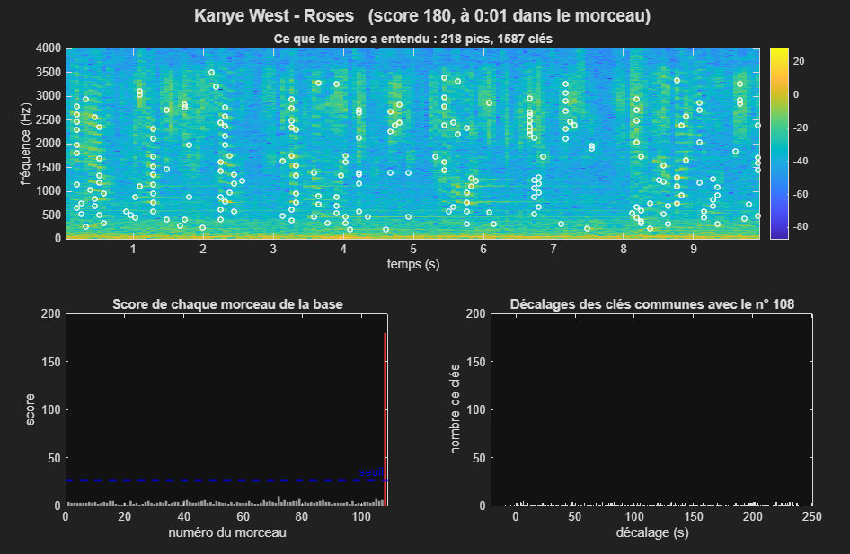
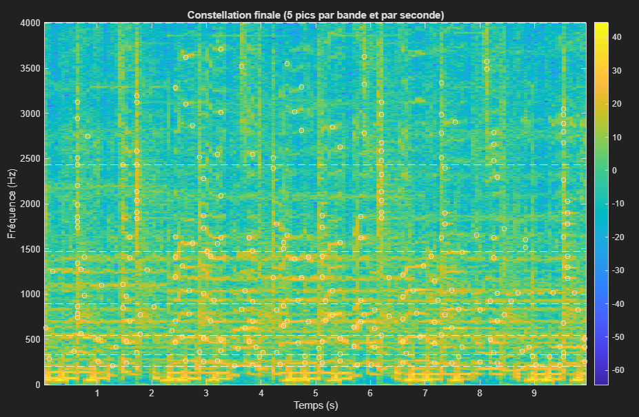
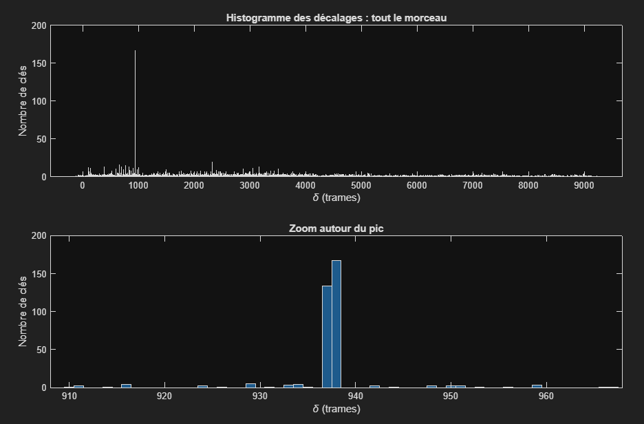
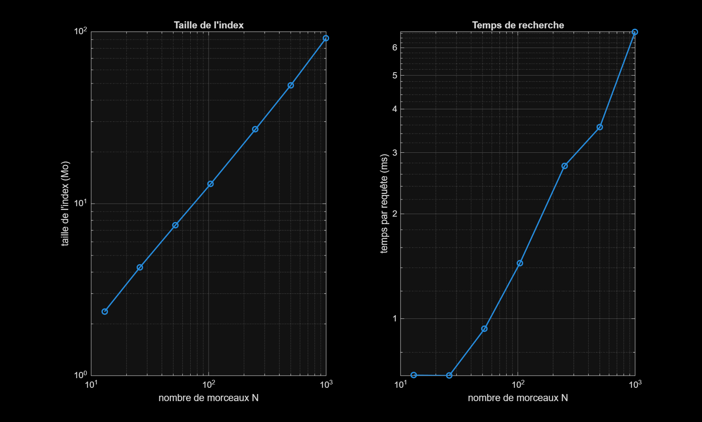

# Shazam en MATLAB : reconnaissance musicale par empreintes audio

Retrouver un morceau à partir de 10 secondes captées au micro, même bruitées, compressées ou réverbérées, et dont on ignore la position dans le morceau. Ce projet reconstruit en MATLAB la méthode de **A. Wang (2003)**, à l'origine de Shazam, et l'évalue de façon systématique : chaque paramètre est justifié, chaque dégradation mesurée, et chaque échec expliqué.

Projet de traitement du signal, E4, ESIEE Paris, novembre 2026.
**Auteurs :** Manon SCHIELIN et Thomas QUÉRO.

- 📄 [Rapport technique (PDF)](docs/Rapport_final_Shazam.pdf)
- 🎬 Vidéo de présentation et démonstration : *lien à venir*



## Le principe

Le micro n'entend pas le fichier d'origine $x(t)$, mais $y(t) = \alpha\,(h * x)(t - t_0) + b(t)$ : un volume inconnu, la réponse du haut-parleur et de la pièce, une position inconnue et du bruit. L'empreinte doit donc ignorer tout cela, tout en restant propre à chaque morceau.

1. **Prétraitement** : mono, ré-échantillonnage à 8 kHz (Shannon : la mélodie et les harmoniques fortes sont sous 4 kHz).
2. **Spectrogramme** : fenêtre de Hann de 128 ms, une trame toutes les 64 ms ; on ne garde que le module.
3. **Constellation** : on ne garde que les pics d'énergie (maxima locaux sur 11 × 7 cases, au-dessus de la médiane du canal + 10 dB, 5 pics par bande et par seconde), soit environ 26 pics/s. Leur **position** survit au bruit, au filtrage et au MP3, leur amplitude non.
4. **Empreintes** : chaque pic est relié à ses 10 voisins suivants ; une clé est le triplet *(fréquence de l'ancre, fréquence de la cible, écart de temps)*. Elle ne dépend pas de l'instant où l'écoute commence.
5. **Index inversé et alignement** : pour le bon morceau, toutes les clés communes tombent au **même décalage temporel**, ce qui fait un pic dans l'histogramme des décalages ; le score est la hauteur de ce pic.
6. **Décision** : le meilleur morceau si son score dépasse un seuil adapté à la durée d'écoute, sinon « inconnu ».

| Constellation de pics | Alignement : le pic de l'histogramme des décalages |
| --- | --- |
|  |  |

## Résultats

Base de 104 morceaux libres de droits (*Free Music Archive*, 8 genres) et 56 morceaux absents de la base pour mesurer les fausses détections.

| Situation | Bonne reconnaissance | Fausses détections |
| --- | --- | --- |
| Extraits de 10 s, sans dégradation | 100 % | 0 % |
| Bruit blanc à 10 dB / 0 dB (10 s) | 95 % / 79 % | 0 % |
| MP3 jusqu'à 32 kbit/s (5 s) | 98 % | 0 % |
| Filtre « téléphone » 300–3 400 Hz (5 s) | 97 % | 0 % |
| Réverbération T60 = 1 s, sans son direct (5 s) | 81 % | 0 % |
| Téléphone dans une salle, à 1 m / à 7 m (10 s) | 8/8 / 7/8 | 0 |

- **Le système ne s'est jamais trompé de morceau** : quand il échoue, il répond « inconnu ».
- **Passage à l'échelle** : avec 1 000 morceaux, l'index fait 92 Mo et une recherche prend 6,7 ms (31 fois plus rapide qu'avec la première version, dont le temps croissait comme $N^2$).
- Les échecs sont analysés dans le rapport : genre *Experimental* (peu de pics stables), voix forte près du micro, écho de la pièce, et un piège réel : la suppression d'écho de Windows effaçait la musique jouée par le PC.



## Lancer la démonstration

1. MATLAB avec la *Signal Processing Toolbox* et l'*Image Processing Toolbox*.
2. Dans MATLAB, depuis ce dossier :

```matlab
init_projet
main
```

3. Jouer un morceau près du micro, appuyer sur Entrée : le programme écoute 10 s et affiche le morceau reconnu, sa position, la constellation, les scores et l'histogramme des décalages. Taper `q` pour quitter.

La démonstration n'utilise que `resultats/index_demo.mat` (104 morceaux FMA et 4 morceaux connus) : elle ne demande pas la base audio. Sous Windows, désactiver les « Améliorations audio » du micro, sinon la suppression d'écho efface la musique.

## Organisation du code

| Dossier | Contenu |
| --- | --- |
| `fonctions/` | une fonction par étape : `pretraitement`, `spectrogramme`, `detection_pics`, `selection_pics`, `empreintes`, `extraction`, `construire_index`, `rechercher`, `decider`, et les dégradations simulées (bruit, bruit réel, MP3, filtrage, réverbération) |
| `tests/` | un script de test par fonction, avec les valeurs attendues |
| `outils/` | un script par expérience du rapport, chacun avec sa graine aléatoire (résultats reproductibles) |
| `resultats/` | index, résultats `.mat`, figures et listes de morceaux (`liste_morceaux.csv`) |
| `docs/` | rapport et images du README |

## Reproduire les évaluations

Les scripts d'évaluation relisent les morceaux de la base. Il faut télécharger [`fma_small.zip`](https://os.unil.cloud.switch.ch/fma/fma_small.zip) (7,2 Go, projet [FMA](https://github.com/mdeff/fma)) et l'extraire dans un dossier `fma/` **à côté** de ce dossier (`../fma/fma_small/...`), avec le fichier `fma_small_genres.csv` (identifiant, genre, chemin). Les essais MP3 demandent [ffmpeg](https://ffmpeg.org/). Le bruit de conversations utilisé pour le « brouhaha » vient d'un bruitage présenté comme libre de droits ([source](https://www.youtube.com/watch?v=bV6nZ5J80j4)), à enregistrer dans `audio/brouhaha.mp3`.

Ne sont pas inclus dans ce dépôt : les fichiers audio des morceaux commerciaux de la démonstration, la base FMA, le bruit de conversations et les enregistrements faits en salle.

## Références

- A. Wang, « An Industrial-Strength Audio Search Algorithm », *ISMIR*, 2003.
- M. Defferrard et al., « FMA: A Dataset for Music Analysis », *ISMIR*, 2017.
- J. Haitsma et T. Kalker, « A Highly Robust Audio Fingerprinting System », *ISMIR*, 2002.
